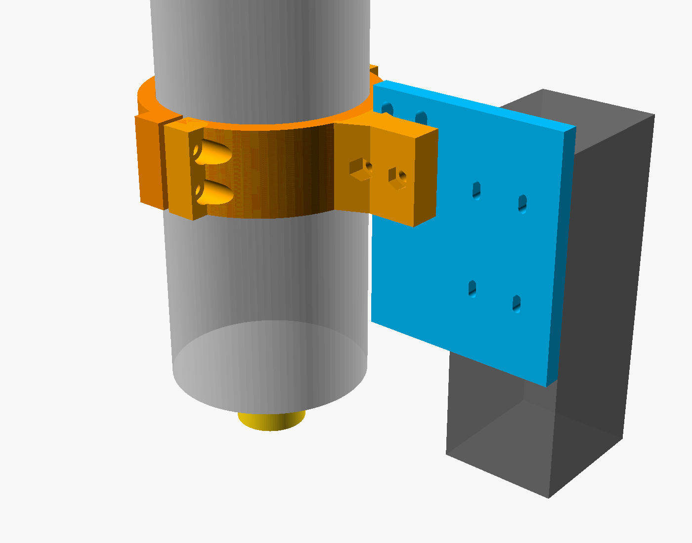
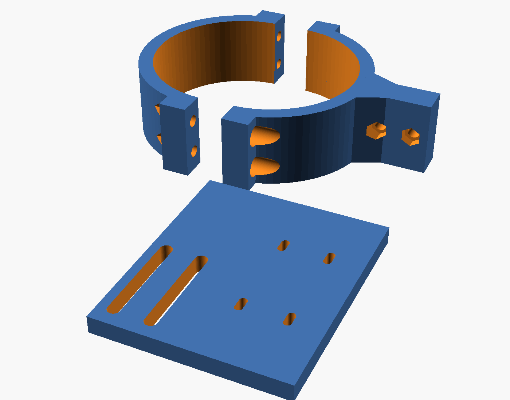

# Sculpfun iR-2 lézertartó spindle-re (LeadCNC 1010)

3D nyomtatható tartó, amivel a **Sculpfun iR-2** (1064 nm, 2 W) lézermodul a **vízhűtéses 2,2 kW-os
spindle testére** szerelhető, így lézerezéshez nem kell leszedni a spindle-t.



## Részek

| Fájl | Leírás | Db |
|---|---|---|
| `stl/clamp_right.stl` | bilincs jobb fele a tartófüllel | 1 |
| `stl/clamp_left.stl` | bilincs bal fele (anyacsapdák) | 1 |
| `stl/bracket.stl` | tartólap: magasságállító hosszlyukak + lézer furatok | 1 |
| `sculpfun_ir2_spindle_mount.scad` | parametrikus forrás (OpenSCAD) | – |



## ⚠️ Nyomtatás előtt mérd meg

Az STL-ek az alapértékekkel készültek. Ha bármelyik eltér, írd át az értéket a `.scad` fájl elején
(OpenSCAD → Customizer) és exportáld újra.

1. **`spindle_d` – a spindle átmérője.** Alapérték: 85 mm. A legtöbb 2,2 kW-os vízhűtéses spindle
   **80 mm**-es, ezért mindenképp mérd meg tolómérővel ott, ahová a bilincs kerül.
2. **`laser_holes` – a lézer rögzítő furatai.** A Sculpfun nem ad ki méretrajzot, ezért **ezek
   helyőrző értékek** (4 db M3, 20 × 40 mm-es raszter). Mérd le a lézer hátlapján lévő menetes
   furatokat, vagy a mellékelt "universal plate" furatkiosztását. A koordináták a lézer hátlapjának
   **felső-közép** pontjától értendők (x oldalra, z lefelé negatív). A furatok 4 mm-es függőleges
   hosszlyukak, így kis eltérést elnyelnek.
3. **`laser_w`** – a lézer lapra fekvő oldalának szélessége (a modul 144 × 50 × 58 mm).
4. **Függőleges hely:** a lézer lencséjének lejjebb kell kerülnie, mint a spindle anyájának/
   szerszámának, különben fókuszáláskor a spindle ér le előbb. Mérd meg, mennyi a bilincs alja
   és a spindle-anya alja közötti távolság, és ehhez állítsd a `laser_top_z` értéket
   (alapból a lézer teteje a bilincs tetejével egy szintben van, a lencse így kb. 110 mm-rel a
   bilincs alja alatt van, ±20 mm állítással).
5. A tartólap a bilincs fölé is kinyúlik (állítástól függően 10–30 mm-rel). Hagyj ennyi helyet a
   bilincs és a gyári spindle-tartó között.

## Szükséges csavarok

- 4 db **M5 × 30** (vagy 35) + 4 db M5 anya – a bilincs összehúzása
- 2 db **M5 × 25** + 2 db M5 anya + 2 alátét – a tartólap rögzítése a fülhöz
- 4 db **M3 × 12** (a lézer furatainak mélységétől függően) – lézer a laphoz
- opcionális: 1 mm-es gumicsík a bilincs belsejébe (ilyenkor `clamp_clearance` += 1)

## Nyomtatás

- Anyag: **PETG** vagy **ASA/ABS** (PLA nem ajánlott: a spindle melegedhet, a PLA kúszik a szorítás alatt)
- Rétegvastagság 0,2 mm, **4–5 fal**, 40 % kitöltés (gyroid)
- A bilincsfeleket állva (ahogy az STL-ben vannak), a tartólapot fektetve kell nyomtatni –
  az STL-ek már így vannak tájolva. Támasz nem kell.
- Az anyacsapdákba nyomd be az anyákat (egy csepp pillanatragasztó segít).

## Összeszerelés

1. Tedd az anyákat a csapdákba, illeszd a két bilincsfelet a spindle-re a gyári tartó **alá**, a
   tartófül a kívánt oldalra nézzen (alapból +X / jobbra). Húzd meg a 4 M5 csavart egyenletesen.
2. Csavarozd a lézert a tartólapra (M3, a lap hátoldaláról).
3. Rögzítsd a tartólapot a fülhöz a 2 M5 csavarral a hosszlyukakon keresztül.
4. **Fókusz:** vedd ki a marószerszámot, a Z-vel menj le a fókusztávolságra, a lapot a hosszlyukban
   tolva állítsd be, hogy a lencse alatta legyen a spindle-anyának, majd húzd meg.

## Szoftver / bekötés

- A lézer és a spindle között **X/Y eltolás** van (alapbeállításnál kb. X +110 mm, Y +44 mm a
  spindle tengelyéhez képest). Ezt LightBurnben (*Device Settings → Laser offset*) vagy
  G-kódban (G92/G54–G55 munkakoordináta) kell kezelni. A pontos értéket egy próbaégetéssel
  mérd ki: jelölj meg egy pontot a marószerszámmal, majd égess a lézerrel ugyanarra a koordinátára.
- Az eltolás miatt a hasznos lézeres munkaterület ennyivel kisebb lesz az egyik oldalon.
- Az iR-2-nek 12/24 V tápellátás és PWM vezérlőjel kell; GRBL-nél `$32=1` (lézer mód) lézerezéshez,
  marás előtt vissza `$32=0`. **A spindle és a lézer soha ne fusson egyszerre.**
- **1064 nm-es IR lézer – csak az erre a hullámhosszra minősített védőszemüvegben használd!**
  A sugár láthatatlan, és a kék (455 nm) lézerekhez való szemüvegek általában NEM védenek ellene.

## Paraméterek módosítása

Nyisd meg a `sculpfun_ir2_spindle_mount.scad`-ot OpenSCAD-ben, a `part` változóval válaszd ki
a részt (`clamp_right`, `clamp_left`, `bracket`, `assembly`), majd F6 → Export STL. Parancssorból:

```sh
openscad -o stl/bracket.stl -D 'part="bracket"' -D 'spindle_d=80' sculpfun_ir2_spindle_mount.scad
```
