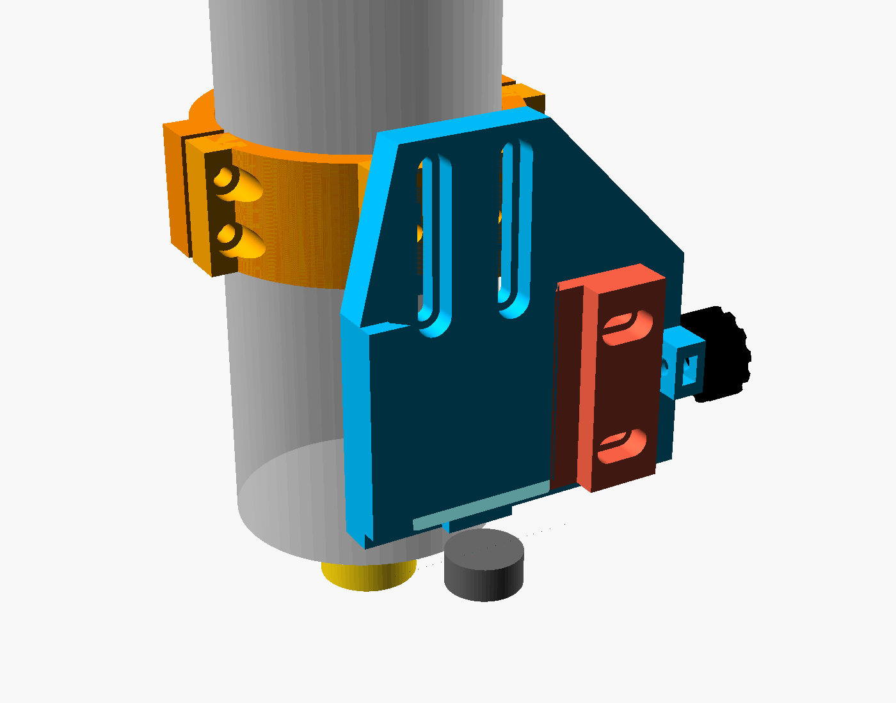
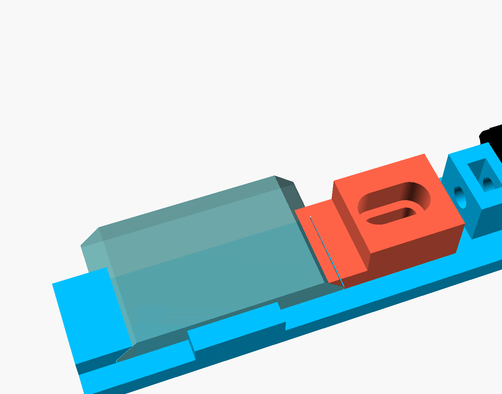

# Sculpfun iR-2 lézertartó spindle-re (LeadCNC 1010)

3D nyomtatható tartó, amivel a **Sculpfun iR-2** (1064 nm, 2 W) lézermodul a **80 mm-es,
vízhűtéses 2,2 kW-os spindle testére** szerelhető, így lézerezéshez nem kell leszedni a spindle-t.
A lézer egy **SF-A9 stílusú fecskefarkas (dovetail) gyorsrögzítőbe** kerül, és egy gombbal
másodpercek alatt ki- és berakható.


## Elrendezés

A tartólap a spindle-lel párhuzamosan, a spindle palástjától **13 mm-re** áll (`plate_gap`).
A lézer közepe a bilincs közepével egy vonalban van, és a lap közvetlenül a bilincs talpára
csavarozódik a lézer közepénél. Így a lézer nem lóg ki oldalra, a kar rövid, kevesebb a rezgés.




## Működés

- A lézer hátulján lévő gyári sín (5,8 mm vastag, 45°-os oldalak) egy fix és egy mozgó pofa
  közé fekszik.
- A lézert **felülről csúsztatod be**, amíg a sín alja el nem éri az **alsó ütközőt**. Így
  minden behelyezés után ugyanabba a magasságba kerül, a fókusz nem változik.
- A **gombos M5 csavar** oldalról nyomja a mozgó pofát, és a 45°-os ferde felületek a lézert a
  laphoz szorítják.
- **Kivétel:** a gombot lazítsd meg fél-egy fordulatot, és húzd ki a lézert felfelé.



## Részek

| Fájl | Leírás | Db |
|---|---|---|
| `stl/clamp_right.stl` | bilincs jobb fele a tartólap talpával | 1 |
| `stl/clamp_left.stl` | bilincs bal fele (anyacsapdák) | 1 |
| `stl/bracket.stl` | tartólap: magasságállító hosszlyukak, fix pofa, alsó ütköző, ellentartó | 1 |
| `stl/jaw.stl` | mozgó pofa | 1 |
| `stl/knob.stl` | recés gomb M5 hatlapfejű csavarhoz | 1 |
| `stl/receiver_test.stl` + `stl/jaw_test.stl` | **20 mm-es próbadarab** mozgó pofával: ezt nyomtasd ki először, és próbáld rá a sínre | 1+1 |
| `sculpfun_ir2_spindle_mount.scad` | parametrikus forrás (OpenSCAD) | – |


## ⚠️ Mielőtt kinyomtatod a nagy lapot

1. **`rail_w`: a sín legszélesebb mérete** (a lézertől legtávolabbi lapon, élétől élig). A
   fotódból becsülve **51 mm** van beállítva. Kérlek, mérd le tolómérővel! A mozgó pofa
   −3/+5 mm-t tud állítani, így a kis eltérés nem gond, de a pontos érték jobb.
2. **Nyomtasd ki a `receiver_test.stl` + `jaw_test.stl` párost** (kb. 30 perc), szereld össze
   1 M4 + 1 M5 csavarral, és próbáld rá a lézer sínjére. Ha jól fogja, jöhet a
   nagy lap. Ha nem, állítsd a `rail_w`, `rail_lip`, `rail_clr` értékeket.
3. **Függőleges hely (`rec_z0`)**: a sín alja (az ütköző) alapból 60 mm-rel van a bilincs alja
   alatt. A lézerház alja kb. 12 mm-rel van a sín vége alatt, a fókuszgomb további ~10 mm-rel,
   tehát a lencse kb. 82 mm-rel van a bilincs alja alatt (±20 mm a hosszlyukakkal).
   **A lencsének lejjebb kell lennie, mint a spindle anyájának** (kivett szerszámmal). Mérd le
   a bilincs helye és a spindle-anya alja közötti távolságot, és ha kell, módosítsd a
   `rec_z0`-t, vagy rakd lejjebb/feljebb a bilincset a spindle testén.
4. A tartólap a bilincs fölé 10–30 mm-rel kinyúlik, ennyi hely kell a bilincs és a gyári
   spindle-tartó között.

## Szükséges csavarok

| Mire | Csavar | Db |
|---|---|---|
| bilincs összehúzása | M5 × 30 + M5 anya | 4 |
| tartólap a bilincs talpára | **M5 × 16** hengeresfejű (imbusz) + M5 anya + alátét | 2 |
| mozgó pofa vezetése | M4 × 16 (hengeresfejű) + **M4 nyloc anya** | 2 |
| szorítócsavar | M5 × 25 **hatlapfejű** + M5 anya (a gombba nyomva) | 1 + 1 |

A gomb helyett vehetsz **M5-ös állítható szorítókart** (az SF-A9-en is ilyen piros kar van),
az ugyanide csavarható.

## Nyomtatás

- Anyag: **PETG** vagy **ASA/ABS**
- 0,2 mm réteg, **4–5 fal**, 40 % gyroid kitöltés
- Az STL-ek nyomtatási tájolásban vannak, támasz nem kell (a 45°-os alávágás támasz nélkül
  nyomtatható).
- A tartólap kb. 102 × 112 × 11 mm, ez a legtöbb tárgyasztalra ráfér.

## Összeszerelés

1. Bilincs: anyák a csapdákba, a két fél a spindle-re a gyári tartó **alá**, a talp arra
   nézzen, ahová a lézert szeretnéd. Ha a hátsó szorítófül a Z-kocsiba ütközne, forgasd el a
   bilincset a spindle körül (pl. lézer elöl, fülek oldalt). Húzd meg egyenletesen a 4 M5-öt.
2. Mozgó pofa: tedd a lap hátoldalán lévő hatszög zsebekbe az M4 nyloc anyákat, majd a két M4
   csavart a pofa hosszlyukain át. **Csak annyira húzd meg, hogy a pofa még csússzon, de ne
   lötyögjön** (a nyloc anya megtartja a beállítást).
3. M5 anya az ellentartó felső hornyába, a hatlapfejű M5 csavart nyomd a gombba, és csavard be.
4. M5 anyákat a talp felső hornyaiba, majd a tartólapot a 2 M5 × 16-tal a hosszlyukakon át a
   talpra csavarozod. A csavarfejek a lapba süllyednek, a lézer sínje átcsúszik felettük.
   **Ne használj 16 mm-nél hosszabb csavart**, mert a spindle-hez érhet.
5. Lézer be felülről az ütközőig, szorítsd meg a gombot.
6. **Fókusz:** (a lézert kivéve érhetők el a csavarok) kivett szerszámmal a Z-vel menj le, a
   tartólapot a hosszlyukakban tolva állítsd
   be, hogy a lézer fókuszban legyen, és a spindle-anya ne érjen le. Ezt csak egyszer kell
   megcsinálni, utána az ütköző miatt a lézer mindig ugyanoda kerül.

## Szoftver / bekötés

- A lézer és a spindle között **X/Y eltolás** van: alapbeállításnál kb. **X +95 mm, Y 0 mm**
  a spindle tengelyéhez képest. Ezt LightBurnben (*Device Settings → Laser offset*) vagy külön
  munkakoordináta-rendszerrel (G54/G55) kell kezelni. A pontos értéket próbaégetéssel mérd ki.
- Az eltolás miatt a lézeres munkaterület ennyivel kisebb.
- Az iR-2-nek 12/24 V és PWM vezérlőjel kell. GRBL-nél lézerezéshez `$32=1`, marás előtt `$32=0`.
  **A spindle és a lézer soha ne fusson egyszerre.**
- **1064 nm-es IR lézer: csak erre a hullámhosszra minősített védőszemüvegben használd!**
  A sugár láthatatlan, és a kék (455 nm) lézerekhez való szemüvegek általában NEM védenek ellene.

## Paraméterek módosítása

Hasznos paraméterek: `plate_gap` (lap–spindle távolság, alap 13 mm), `knob_side` (1 / -1: a
gomb melyik oldalra nézzen), `rec_z0` (lézer magassága), `rail_w` (sín szélessége).

Nyisd meg a `sculpfun_ir2_spindle_mount.scad`-ot OpenSCAD-ben (Window → Customizer), a `part`
változóval válaszd ki a részt, majd F6 → Export STL. Parancssorból:

```sh
openscad -o stl/bracket.stl -D 'part="bracket"' -D 'rail_w=50.5' sculpfun_ir2_spindle_mount.scad
```
